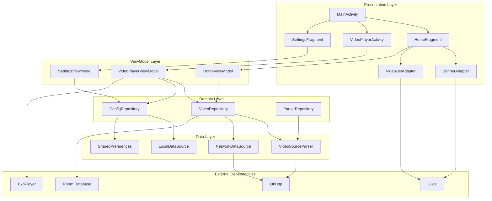

# 设计文档：AndroLua 应用迁移到 Kotlin

## 概述

本设计文档描述了将基于 AndroLua (Lua 语言) 的 Android 视频播放器应用完整迁移到 Kotlin 的技术方案。该应用是一个功能完整的视频播放器，支持多种视频源解析、手势控制、播放列表管理、弹幕显示等功能。迁移目标是保持所有现有功能不变，同时采用现代 Android 开发最佳实践（MVVM 架构、Jetpack 组件、Kotlin 协程等）。

原应用使用 AndroLua 框架，通过 Lua 脚本实现业务逻辑，依赖 .dex 文件提供的第三方库（Glide、OkHttp、ExoPlayer2、SmartRefreshLayout 等）。迁移后将使用标准 Android SDK 和 Gradle 依赖管理系统。

## 架构设计

### 整体架构



### 主要工作流程序列图

```mermaid
sequenceDiagram
    participant User
    participant VideoPlayerActivity
    participant VideoPlayerViewModel
    participant VideoRepository
    participant VideoSourceParser
    participant ExoPlayer
    participant NetworkDataSource
    
    User->>VideoPlayerActivity: 启动播放器
    VideoPlayerActivity->>VideoPlayerViewModel: 初始化 ViewModel
    VideoPlayerViewModel->>VideoRepository: 获取视频信息
    VideoRepository->>VideoSourceParser: 解析视频源
    VideoSourceParser->>NetworkDataSource: 发起 HTTP 请求
    NetworkDataSource-->>VideoSourceParser: 返回网页内容
    VideoSourceParser-->>VideoRepository: 返回视频 URL
    VideoRepository-->>VideoPlayerViewModel: 返回播放数据
    VideoPlayerViewModel->>ExoPlayer: 准备播放器
    ExoPlayer-->>VideoPlayerViewModel: 播放器就绪
    VideoPlayerViewModel-->>VideoPlayerActivity: 更新 UI 状态
    VideoPlayerActivity-->>User: 显示视频画面
    
    User->>VideoPlayerActivity: 手势操作（滑动/点击）
    VideoPlayerActivity->>VideoPlayerViewModel: 处理手势事件
    VideoPlayerViewModel->>ExoPlayer: 调整播放参数
    ExoPlayer-->>VideoPlayerViewModel: 状态更新
    VideoPlayerViewModel-->>VideoPlayerActivity: 更新 UI
